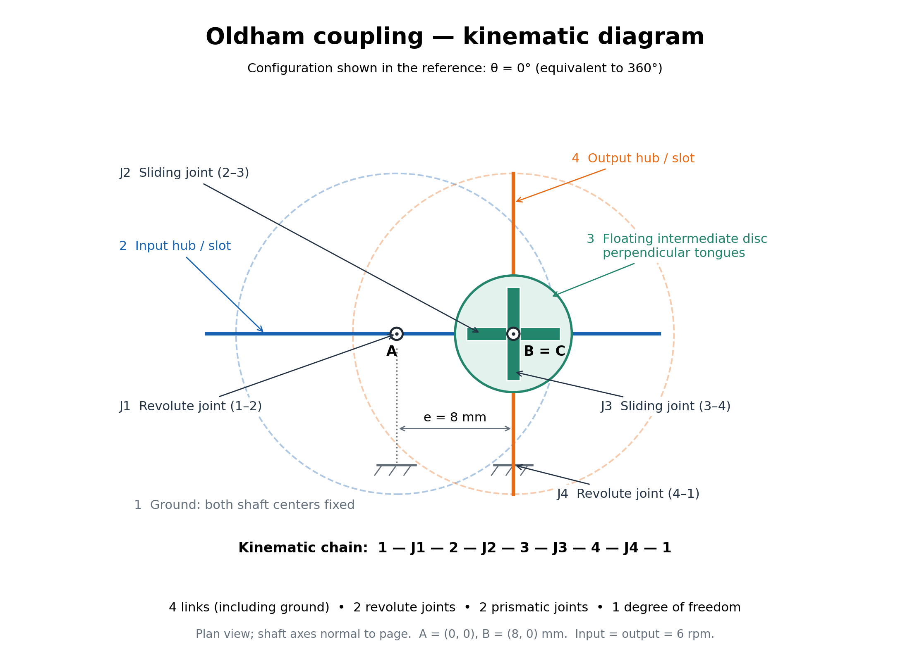

# Oldham Coupling: Symbolic Kinematics

2103-322 Design of Mechanism | Term Project 2569

Symbolic position, velocity and acceleration analysis of an Oldham coupling connecting parallel shafts with an 8 mm offset at 6 rpm.



## Deliverables

| File | Contents |
|---|---|
| [Report draft](Oldham%20Coupling%20Report.docx) | Existing report; placeholders remain |
| [Mechanism.m](Mechanism.m) | Standalone symbolic analysis for Part II |
| [RUN_ALL.m](RUN_ALL.m) | Run analysis and export plots, data and animation |
| [Oldham_Coupling.slx](Oldham_Coupling.slx) | Existing Simscape Multibody model; simulation pending |
| [Kinematic diagram](Oldham_kinematic_diagram.svg) | Link, joint and geometry illustration |
| [Submission package](submission/README.md) | Self-contained package with Parts I-IV and evidence checklist |

## Mechanism model

The frame, input hub, floating disc and output hub form four links. Two revolute joints and two perpendicular prismatic joints give planar mobility

```math
M=3(n-1)-2j_1-j_2=3(4-1)-2(4)=1.
```

With fixed shaft centers A = (0,0), B = (e,0), and perpendicular slide directions u = (cos theta, sin theta), v = (-sin theta, cos theta), loop closure is C = A + q1*u = B + q2*v.

## Symbolic analysis

```math
q_1=e\cos\theta,\qquad q_2=e\sin\theta,
```
```math
C=\left(\frac e2(1+\cos2\theta),\frac e2\sin2\theta\right),
\qquad \dot q=\frac{dq}{d\theta}\omega,
\qquad \ddot q=\frac{d^2q}{d\theta^2}\omega^2+\frac{dq}{d\theta}\alpha.
```

The ideal output/input speed ratio is 1:1. At e = 8 mm, each slider has 16 mm peak-to-peak travel and the disc center follows a 4 mm radius circle twice per input revolution. At 6 rpm, one revolution takes 10 s. These are analytical predictions.

## Run

Use MATLAB with Symbolic Math Toolbox. Open `RUN_ALL.m` and click Run, or execute:

```matlab
run('RUN_ALL.m')
```

Outputs are saved in `submission/results/main/`: `Render.png`, `Kinematics.fig`, `analytical_samples.csv`, and `Mechanism.avi`. The video is a schematic analytical animation. MATLAB needs a graphical session for video capture. To export plots and data without video:

```matlab
addpath('submission/simulation')
result = run_main(fullfile(pwd, 'submission', 'results', 'main'), false);
```

For the Simscape model, follow the separate [run guide](submission/simulation/README.md). It requires Simulink, Simscape and Simscape Multibody.

## Validation and remaining work

The existing symbolic script checks slider travel and disc-center radius. MATLAB execution and Simscape validation remain pending; see [verification notes](submission/docs/verification.md). Add team details, actual simulation output and prototype evidence before submission. The ideal model assumes rigid parts, parallel shafts, perpendicular slides, and no clearance; it does not calculate forces or strength.

## Reference

Repository presentation and the one-command workflow were inspired by [Beam004MECU/Cam-Follower-Symbolic](https://github.com/Beam004MECU/Cam-Follower-Symbolic). The Oldham equations and added runner use this project's mechanism. Reference source code and media were not copied. See [adaptation notes](submission/docs/reference-adaptation.md).
